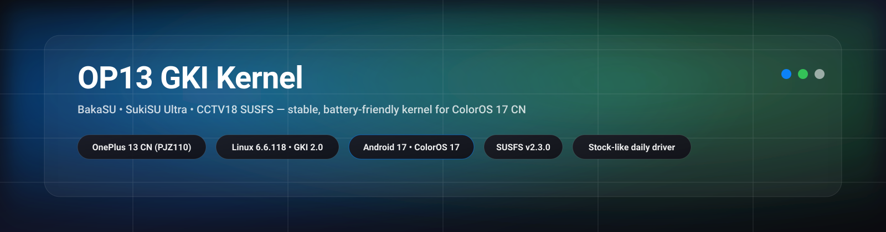

<!--
  Op13_Susfs_kernel — README
  Repo: ox1d3x3/Op13_Susfs_kernel
  README revision: 2026-10-27 (SukiSU Ultra v114 + fork UAPI 5 repair · BakaSU v111)
-->

<h1 align="center">If This Kernel is useful to you, a ⭐ helps others find it.</h1>

<div align="center">



<br/>

<!-- Build lanes -->
<a href="../../actions/workflows/Build_ReSukiSU.yml">
  
</a>
<a href="../../actions/workflows/Build%20SukiSU_Ultra.yml">
  
</a>

<br/>

<a href="../../releases">
  
</a>
<a href="../../releases">
  
</a>
<a href="../../commits">
  
</a>


<br/>


</div>

---

## Overview

A daily‑driver focused **Linux 6.6 GKI 2.0** kernel for the **OnePlus 13 CN**
(`PJZ110` / `sun` / `SM8750`), built entirely from GitHub Actions and targeting
**ColorOS 17 CN (Android 17)**. The goal is a **stock‑like, stable, battery‑friendly
baseline** with modern root + SUSFS hiding — not a maxed‑out benchmark build.

Two root solutions are offered as separate build **lanes**, both sharing the same
CCTV18 OP13 source, toolchain and SUSFS tree:

| Lane | Workflow | Root solution | Manager APK | Pick it if… |
|---|---|---|---|---|
| **BakaSU** (Recommended) | `Build_ReSukiSU.yml` | [BakaSU](https://github.com/Baka-SU/BakaSU) (formerly ReSukiSU) | latest BakaSU manager | you want the daily driver — the most tested lane |
| **SukiSU Ultra** | `Build SukiSU_Ultra.yml` | [SukiSU‑Ultra](https://github.com/SukiSU-Ultra/SukiSU-Ultra) (`builtin` branch + UAPI 5 repair) | UAPI-compatible stable release selected at build time | you want SukiSU Ultra with KPM support |

> [!IMPORTANT]
> **SukiSU Manager pairing:** this fork retains the builtin UAPI 5 repair.
> `auto` checks the selected stable Manager's UAPI before building. Install the
> matching Manager release shown in the build summary; the earlier repair build
> used v4.2.1 / 40994.

> **About "android15" in the version string.** `uname -r` contains
> `android15-8` on **stock ColorOS 17 too** — it names the GKI kernel branch
> (`android15-6.6`), not the Android version. OnePlus ships the 6.6 GKI kernel on
> Android 17, so this is correct and must not be changed.

> **ReSukiSU is now BakaSU.** The project was renamed upstream; the workflow file
> keeps its old name (`Build_ReSukiSU.yml`) so existing Actions links and history
> keep working.

> **KernelSU‑Next lane is DEPRECATED** (archived at
> [`docs/deprecated/Build_KSUN.yml.deprecated`](./docs/deprecated/Build_KSUN.yml.deprecated)).
> See [`docs/deprecated/WHY_KSUN_DEPRECATED.md`](./docs/deprecated/WHY_KSUN_DEPRECATED.md).

> **Current release line: SukiSU Ultra `v114` · BakaSU `v111`** — ColorOS 17
> stock uname, ADIOS + Re:Kernel + Baseband‑Guard actually enabled, two
> upstream security fixes. See
> [`docs/RELEASE_v114_v111.md`](./docs/RELEASE_v114_v111.md).

---

## Build matrix

Both lanes are **manually triggered** (`workflow_dispatch`) and every upstream is
**pinned to a commit**, because unpinned upstreams have broken this project
several times.

| Component | Source | Pin |
|---|---|---|
| Kernel | `cctv18/android_kernel_common_oneplus_sm8750` @ `oneplus/sm8750_b_16.0.0_oneplus_13_6.6.118` | `2a4726b` (6.6.118) |
| SUSFS — BakaSU lane | `cctv18/susfs4oki` (`oki-android15-6.6`) | `3f6aae5` (v2.3.0) |
| SUSFS — SukiSU lane | `cctv18/susfs4oki` (`oki-android15-6.6`) | `3f6aae5` (v2.3.0) + SELinux helper patch |
| BakaSU driver | `Baka-SU/BakaSU` `main` | `d7260ca` |
| SukiSU driver | `SukiSU-Ultra/SukiSU-Ultra` `builtin` | `0af2cf9` + UAPI 5 / manager / static-key repairs |
| Build assets | `cctv18/oppo_oplus_realme_sm8750` | `21db9e7` |
| Packaging | [osm0sis/AnyKernel3](https://github.com/osm0sis/AnyKernel3) | `020dfec` |
| Toolchain | CCTV18 prebuilt LLVM/Clang 18 (`r510928`) | release tag |

> **Keep driver and SUSFS paired.** Both defaults use `3f6aae5`. SukiSU's exact
> `0af2cf9` / `3f6aae5` pair receives the kernel SELinux helper wrappers and
> retains its policy-query guard. Upstream's alternative `2d1de62` / `2919a9a`
> pair retains its hook-enabled path. BakaSU uses its own SELinux hiding.
> Both workflows check the driver/SUSFS generation before applying patches.

### Key inputs (set them when you press *Run workflow*)

| Input | What it does | Default |
|---|---|---|
| `profile` | `stock_daily` / `stock_plus` / `minimal_safe` / `debug_only` | `stock_daily` |
| `sukisu_ref` / `resukisu_ref` | Root driver commit (keep paired with `susfs_ref`) | pinned commit |
| `sukisu_driver_version` | Latest official stable Manager versionCode or a compatibility value | `auto` (resolved at build time) |
| `susfs_ref` | SUSFS commit | pinned commit |
| `SUSFS` | Enable CCTV18 SUSFS | On |
| `susfs_patch_policy` | `audited_cctv18` / `strict` / `native_cctv18` | `audited_cctv18` |
| `hook_mode` | Hook target (inline SUSFS vs. auto/test modes) | `inline_susfs` |
| `kpm_enable` | Kernel‑side KPM (SukiSU only; BakaSU has none) | SukiSU: on · BakaSU: off |
| `kernel_suffix` | Stock‑mimic `LOCALVERSION` (controls `uname -r`) | ColorOS 17 CN stock value |
| `kernel_name` | Display banner shown by the flasher | lane name |
| `optimise` | `O2` (stable) or `O3` (test‑only) | `O2` |
| `zram_module` / `zram_comp` | Extra LZ4/LZ4HC/ZSTD support / generic module's preferred compressor; ZRAM and ZSMALLOC stay modular | On / `lz4` |
| `lz4_zram_patch` | Extra LZ4 ZRAM patch (touches kernel headers → KMI risk) | Off |
| `bbr` | TCP BBR (`On` = available, `Default` = default congestion control) | On |
| `proxy` | Netfilter extras (HL target/match, IP_SET) | On |
| `adios` | Make ADIOS the default I/O scheduler instead of retaining the firmware policy | Off |
| `rekernel` / `bbg` | Re:Kernel / Baseband‑Guard | On |
| `fengchi` | FengChi/HMBIRD scheduler (experimental) | Off |
| `BUILD_USER` / `BUILD_HOST` | `/proc/version` identity | `kleaf` / `build-host` (stock GKI) |
| `clean_ccache` | Wipe ccache before building | false |

### SukiSU version dropdown

**Sync SukiSU versions** refreshes the dropdown daily at 10:23 Asia/Shanghai
(GitHub scheduling may be delayed), or when run manually. It keeps `auto`, the
latest official stable versionCode, `40994`, `40900`, and `40796`. A changed release
creates one commit on the default branch; unchanged releases create none.

Set the repository Actions secret `SUKISU_VERSION_SYNC_TOKEN` to a fine-grained
token limited to this repository with **Contents: read and write** and
**Workflows: read and write**. The default `GITHUB_TOKEN` cannot update workflow
files ([permission requirements](https://docs.github.com/en/rest/repos/contents#create-or-update-file-contents)).
Branch protection must permit the token's owner to push; a rejected push
fails the sync rather than bypassing protection.

The build summary shows the resolved driver version, selected source commit,
and driver/Manager UAPI before compilation. `auto` reads the official release's
UAPI header and rejects mismatches before overriding the numeric driver
version. Explicit numeric selections remain available for legacy pairs and are
marked `manual-unchecked`; they do not validate Manager compatibility.

For this release, select `40994` and install SukiSU Manager **v4.2.1** (UAPI 5).
The latest v4.2.1-r2 / 41068 uses UAPI 6; `auto` rejects that newer interface
against the current UAPI 5 driver. `40994` stays in the compatibility choices
after scheduled refreshes.

The SukiSU default pairs builtin `0af2cf9` with CCTV18 SUSFS `3f6aae5` (v2.3.0).
The repository's pinned-source patch completes UAPI 5 reporting and bundled-LKM
flags, and repairs the missing manager ioctl declaration and package-scan build
error. It also aligns the su-compat switch with SUSFS's static-key ABI; the
build checks that the linked symbol is not a one-byte bool. Scoped su-session
descriptors and services start/skip handling are
already present in that builtin source. Selecting a version does not upgrade
SukiSU or SUSFS source refs and does not establish firmware compatibility.
See the [Manager compatibility decision](.agents/notes/implemented/bug-fix/2026-10-17-sukisu-uapi-manager-compatibility.md)
for the source audit and successful repair build.

> **Feature inputs:** ADIOS and Re:Kernel use the existing kernel sources;
> Baseband‑Guard installs its pinned LSM source. FengChi/HMBIRD and extra
> compression patches remain best-effort. Check `_ox_debug/optional-patches.log`
> and `config-scan.txt` for each build's actual result.

> **Moving ROMs?** `kernel_suffix` defaults to the ColorOS 17 CN stock value
> `android15-8-g9bc34d5b0c79-abogki537459655-4k`. For ColorOS 16 use
> `android15-8-g93e223c276e7-abogki500782043-4k`. The kernel source is the same
> 6.6.118 for both.

### Outputs

Each run uploads one artifact containing:

- `Image_OP13_…` — raw kernel image (+ `.sha256`)
- `AK3_OP13_…_FLASH_THIS.zip` — AnyKernel3 flashable ZIP (+ `.sha256`)
- `_ox_debug/` — logs, final `.config`, patch audit and check results:
  - `pairing.txt` — must say `pairing: OK`
  - `susfs-config-audit.txt` — every requested SUSFS option is `=y`
  - `cve-status.txt`, `sec-posix-timers.txt` — security fixes applied

---

## Features

- **GKI 2.0** packaging as an AnyKernel3 flashable ZIP
- **Root:** BakaSU **or** SukiSU Ultra (one per lane)
- **SUSFS v2.3.0** (CCTV18 `susfs4oki`) with inline hook — SUS path / mount /
  kstat / map, `uname` spoof, cmdline/bootconfig spoof, open‑redirect, KSU/SUSFS
  symbol hiding (SUSFS logging is off to save battery)
- **SELinux context hiding** — BakaSU's own implementation, or SukiSU builtin's
  with the matching SUSFS pair
- **Stock‑mimic identity** — `uname -r` matches ColorOS 17 CN exactly (no trailing
  `+`), and `/proc/version` reports the stock `kleaf@build-host`
- Optional **ADIOS** default I/O scheduler, **Re:Kernel**, **Baseband‑Guard** LSM
- **Vendor-compatible modular ZRAM** with LZ4 / LZ4HC / ZSTD support, **TCP BBR**, **NTSYNC**, netfilter extras
- **Security fixes** on top of CCTV18's source: CVE‑2026‑43499 (rtmutex) and the
  6.6‑stable posix‑cpu‑timers use‑after‑free fix
- **KPM** support on the SukiSU lane, including final-Image KernelPatch injection
  and standalone/AnyKernel3 Image consistency checks; no modules bundled

**Companion module:** **X1 Kernel Manager** (`ox_op13_kernel_manager`) — WebUI
for profiles, ZRAM, charging and live stats, plus the SUSFS privacy layer (path /
map / uname / mount hiding) and an attestation preflight. Runtime tuning lives in
the module rather than the kernel, to stay within GKI 2.0 KMI limits.

---

## Safety first

> ⚠️ Flashing kernels can cause **bootloops**, **soft‑bricks**, **data loss** and
> **instability**. You are responsible for what you flash. If you can't recover
> from a bootloop, **don't flash**.

**Back up before flashing.** Back up `boot` and `init_boot`
(and `vbmeta` if your setup uses it).

**If you bootloop:**
1. Reboot to recovery / fastboot.
2. Restore your `boot` / `init_boot` backup (or flash the stock `boot.img` for
   your exact ColorOS build).
3. Reboot.

---

## Install

1. Download the correct `AK3_OP13_…_FLASH_THIS.zip` from **Releases** (or the
   **Actions** run artifact).
2. Flash it with a kernel flasher or your root manager's AnyKernel3 flasher.
3. Reboot.
4. Install the matching manager APK — **BakaSU:** latest BakaSU manager ·
   **SukiSU:** the release recorded in the build summary.
5. Optional: install **X1 Kernel Manager**. On BakaSU, mount hiding needs the
   `ksu_susfs` binary (from the susfs4ksu module); SukiSU v4.2.0's `ksud` has it
   built in.

> Switching lanes (e.g. SukiSU → BakaSU)? Reinstall your SUSFS/manager modules
> afterwards to clear stale state.

---

## Verify after flashing

```sh
# Stock-mimic uname — should end in "-4k" with no trailing "+"
uname -r
# expected: 6.6.118-android15-8-g9bc34d5b0c79-abogki537459655-4k

# SUSFS kernel options
su -c 'zcat /proc/config.gz | grep -E "^CONFIG_KSU_SUSFS(_SUS_PATH|_SUS_MOUNT|_SUS_KSTAT|_SUS_MAP|_SPOOF_UNAME)?="'

# ADIOS scheduler, Re:Kernel, Baseband-Guard
su -c 'zcat /proc/config.gz | grep -E "^CONFIG_(MQ_IOSCHED_ADIOS|REKERNEL|BBG)="'

# ZRAM + active compressor
su -c 'cat /sys/block/zram0/comp_algorithm 2>/dev/null; cat /proc/swaps'

# SukiSU lane: manager crowned early in boot
su -c 'dmesg | grep -E "scanning manager|Crowning manager"'
```

---

## Troubleshooting

- **`su` fails in Termux/adb with `cannot execute: required file not found`, but
  apps still get root** — driver and SUSFS are from different generations. Use
  the pinned defaults; check `_ox_debug/pairing.txt`.
- **SukiSU: root unavailable / App Profile writes fail** — compare the installed
  Manager release and UAPI with the build summary. Rebuild using `auto` for its
  interface check; explicit numeric selections are recorded as `manual-unchecked`.
- **SukiSU: "Failed to grant Root!" until the manager is restarted** — fixed in
  v114 (early manager scan at post‑fs‑data). Update the kernel.
- **SUSFS module "operation not supported" / `0x555e1`** — reinstall the SUSFS
  module after flashing; if you had a different one before, uninstall it, reboot,
  then install the correct one.
- **RAM Expansion unavailable** — both lanes keep `CONFIG_ZRAM=m` and
  `CONFIG_ZSMALLOC=m` so ColorOS can load its vendor HybridSwap modules.
  Check `/sys/block/zram0/hybridswap_core_enable`, `/proc/swaps`, and
  `persist.sys.oplus.nandswap.err`. Error `1004` means the required kernel
  interface is missing. The stock driver controls runtime compression and
  expansion size. New packages stop bundling the property-override module and
  disable an existing `op13_ram_expansion_fix` when its directory is accessible
  during flashing; if `/data` is unavailable, disable that module in the root manager.
- **Bootloop** — restore `boot` / `init_boot`, return to the `stock_daily`
  profile and re‑introduce options one at a time.
- **TEE / Soter attestation flagged by a detector** — expected on an unlocked
  bootloader. The secure world learns the boot state from the boot chain; no
  kernel or module can change that.

---

## Build it yourself

Open **Actions → pick a lane → Run workflow**, choose your inputs, and download
the artifact when it finishes. Start from `stock_daily` + `O2` + inline SUSFS with
the pinned refs, then experiment from a fork. If you change a root ref, change
`susfs_ref` with it — the pairing guard will stop a mismatched build.

### Maintenance utilities
- **Clean Caches** (`Clean Caches.yml`) — purge `ccache-*` Actions caches.
- **Cleanup CCache** (`clean-up.yml`) — bulk cache/run cleanup with filters.
- **Lint Workflows** (`lint.yml`) — actionlint + yamllint on every workflow change.

### Portable composite action (advanced)
`action.yml` is a separate, **device‑agnostic** builder that syncs sources with
Google's `repo` tool (`manifest.xml`), pulls AnyKernel3/`kernel_patches` from
TheWildJames + SUSFS from `simonpunk/susfs4ksu`, and applies a broad OnePlus
patch set. It is intended for forks/other devices and is **not** what the OP13
release lanes above use. See `docs/REVIEW.md`.

---

## Credits

[@cctv18](https://github.com/cctv18) ·
[BakaSU](https://github.com/Baka-SU) ·
[SukiSU‑Ultra](https://github.com/SukiSU-Ultra) ·
[@simonpunk (SUSFS)](https://gitlab.com/simonpunk/susfs4ksu) ·
[@osm0sis (AnyKernel3)](https://github.com/osm0sis) ·
[@mrcxlinux](https://github.com/mrcxlinux) ·
[@WildKernels / @TheWildJames](https://github.com/WildKernels) ·
[KernelSU‑Next](https://github.com/KernelSU-Next) (former lane)

---

## License

Distributed under **GPL‑2.0‑only** (see [`LICENSE`](./LICENSE)), matching the
upstream Linux kernel and SUSFS sources this project builds on. Build glue and
workflows are covered by the same license. Bundled third‑party components
(AnyKernel3, root solutions, CCTV18 patches) remain under their own upstream
licenses — follow those where applicable.
